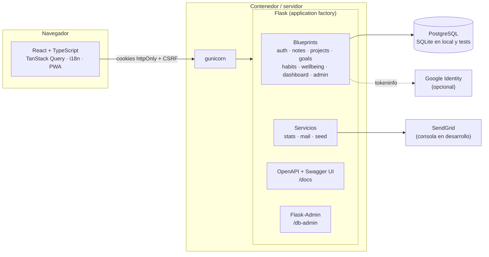
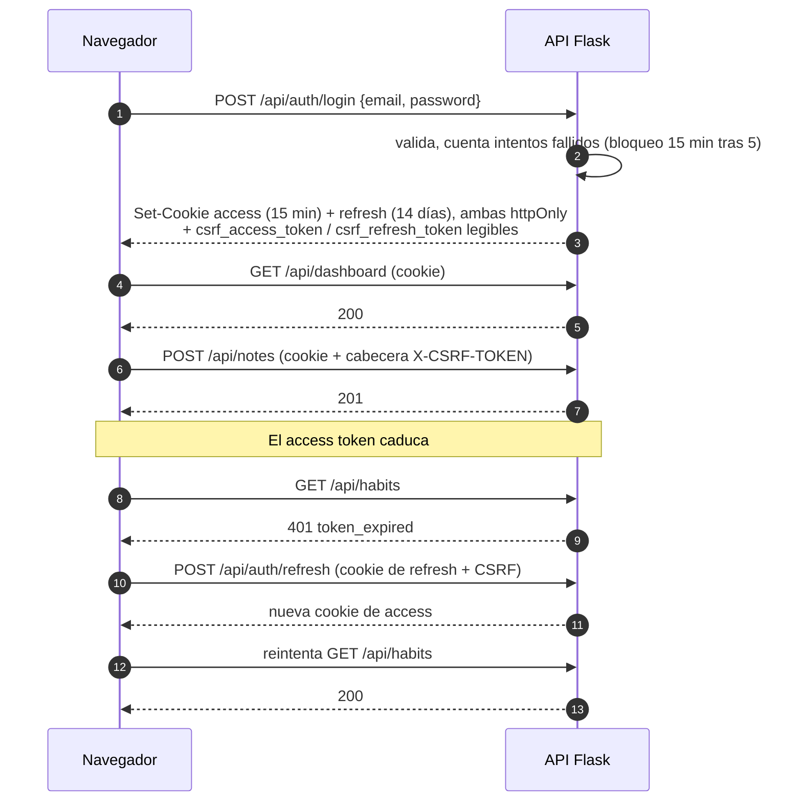
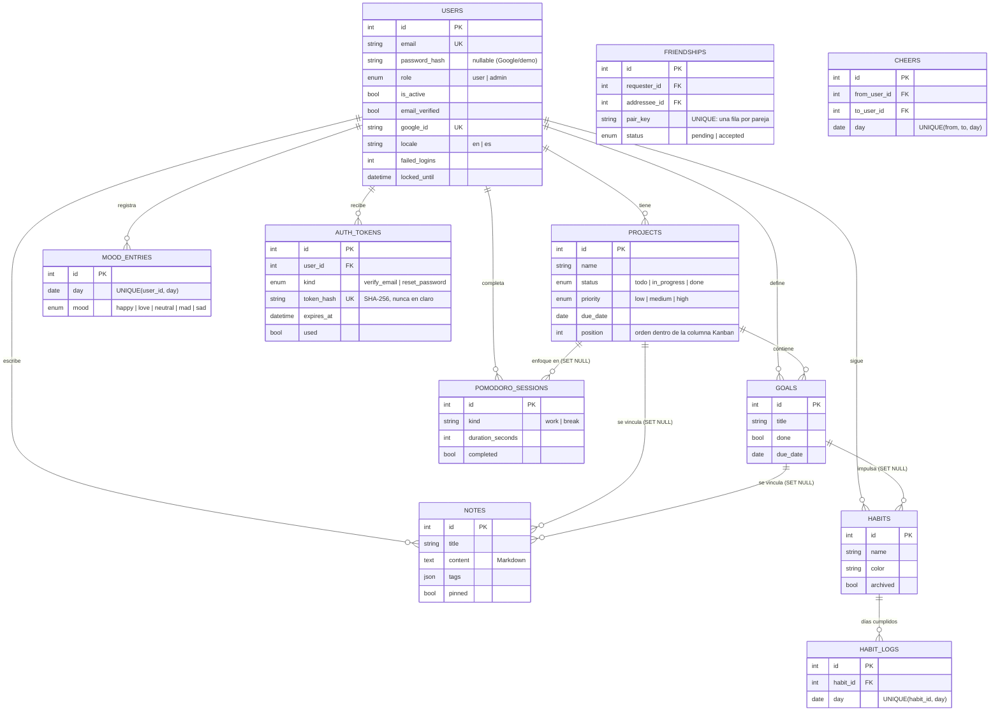

# Arquitectura

## Visión general

El frontend compilado lo sirve el propio Flask, así que navegador y API comparten origen: las cookies de sesión
funcionan sin CORS y sin exponer tokens a JavaScript. En desarrollo, Vite hace de proxy de `/api`.

## Flujo de autenticación

## Modelo de datos

## Decisiones de diseño

| Decisión | Motivo |
| --- | --- |
| JWT en **cookies httpOnly** + CSRF por doble envío | El token no es accesible desde JavaScript, por lo que un XSS no puede robar la sesión. |
| El rol se lee **de la base de datos**, no del token | Desactivar a un usuario o quitarle el rol admin surte efecto de inmediato, sin esperar a que caduque el JWT. |
| Tokens de verificación y reseteo **hasheados (SHA-256)**, de un solo uso y con caducidad | Una fuga de la base de datos no permite resetear contraseñas. Pedir un token nuevo invalida los anteriores. |
| `get_owned()` devuelve **404** (no 403) para objetos de otro usuario | No se revela la existencia de recursos ajenos y se evita el IDOR. |
| `forgot-password` responde siempre 200 | Evita enumerar qué emails están registrados. |
| Esquemas **Pydantic** con `extra="forbid"` | Validación estricta; un cliente no puede enviar campos como `role` en el registro. |
| Hábitos como filas `habit_logs` con `UNIQUE(habit_id, day)` | Marcar/desmarcar es idempotente y las rachas se calculan con funciones puras y testeadas. |
| Kanban con `position` reindexado en servidor | Un movimiento actualiza las dos columnas afectadas de forma consistente; el cliente aplica actualización optimista. |
| Temporizador por **hora de fin**, no restando 1 s por tick | Sigue siendo exacto con la pestaña en segundo plano. |
| OpenAPI generado desde los esquemas Pydantic | La documentación en `/docs` no se desincroniza del código. |
| Códigos de error estables (`error.code`) | El frontend traduce los mensajes por código; la API no depende del idioma. |
| Compañeros: `pair_key` único (`menor-mayor`) y vista por **lista blanca** | Una sola relación por pareja aunque se pidan a la vez, y un compañero nunca recibe campos privados por descuido al añadir columnas. |
| Hábitos **privados por defecto** (`shared = false`) | Compartir es una decisión explícita, hábito a hábito. |
| Un ánimo al día por pareja (`UNIQUE(from, to, day)`) | La regla vive en la base de datos, así que no se salta con peticiones concurrentes. |
